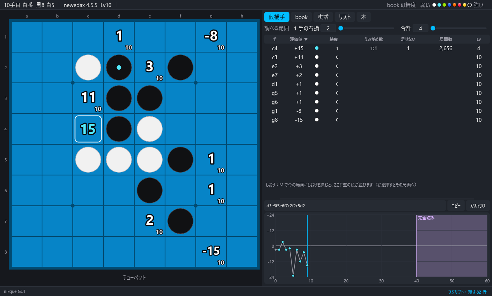

# nikque GUI

[日本語](#日本語) · [English](#english)

## 日本語

オセロのエンジン [Edax 4.5.5 nikque](https://github.com/Nikque/edax-reversi-AVX)（C 版）と [Heath（旧名 newedax）](https://github.com/Nikque/Heath)（C++ 版）を画面から使うための、Windows 用のソフトです。Mac 版（0.4.3 から）と、Linux 版・Android 版（0.4.4 から）もあります。どれもまだ試しの版です。

### できること

- **盤の上に評価値を表示**：すべての合法手の評価値と、book の精度（段階 0〜7）を盤に重ねて表示します。
- **book の解析**：次の精度の段階に足りない局面、うみがめ数（暗記が必要な進行の数）、level ごとの局面数、最善の進行、進行の木。
- **book の学習と整理**：`deviate`・`enhance`・`fill` などの学習を画面から実行。途中で止めて再開でき、複数の学習を順番に並べられます。book を軽くする `book reduce` も使えます。
- **対局**：人対コンピューター、コンピューター同士、持ち時間あり。序盤を book から選べます。
- **棋譜**：100 万局まで扱える棋譜リスト、棋譜検索、盤面の配置、盤面から手順の推定。
- **そのほか**：2 つの棋譜の比較（悪手や違う手に印）、しおり、コマンドを並べたスクリプトの実行。
- **表示言語**：日本語・English・简体中文・繁體中文（中国語は機械翻訳）。

### 使い始め方

1. [最新の Release](https://github.com/Nikque/nikque-gui/releases/latest) の zip をダウンロードし、好きな場所に展開します。インストールは要りません。
2. `nikque-gui.exe` を起動します。

Mac 版・Linux 版・Android 版：

- Mac 版（`nikque-gui-<版>-mac.zip`）：macOS 13 以上の、Apple シリコンと Intel の Mac で動きます（[2 章](manual/ja/02-setup.md#mac試しの版)）。
  1. ZIP を展開します。
  2. 署名していないので、一度だけ「ターミナル」で `xattr -dr com.apple.quarantine <展開したフォルダ>` を実行します。
  3. `nikque GUI.app` を開きます。
- Linux 版（`nikque-gui-<版>-linux.tar.gz`）：x86-64 の Ubuntu 22.04 以上で動きます。GTK 3 を使います。展開して `nikque-gui` を起動します（[2 章](manual/ja/02-setup.md#linux試しの版)）。
- Android 版（`nikque-gui-<版>-android.apk`）：Android 10 以上の arm64 の端末向けです。APK をインストールして開きます。使えるのは、対局・解析・棋譜までです（[2 章](manual/ja/02-setup.md#android試しの版)）。

エンジン 2 つ（Edax nikque と Heath）が同梱されています。**book は付いていません**。お持ちの `book.dat` を使う方法は、マニュアルの [2 章「置き方と起動」](manual/ja/02-setup.md#book-を置く) を見てください。

**マニュアル**：[manual/ja](manual/ja/README.md)

### ビルド

Visual Studio 2022（C++、x64）と CMake を使います。

- `build.cmd`：`build\Release` にビルドし、単体テスト 6 本を実行します。
- `build.cmd measure`：計測用のビルド（`build-measure`）。
- `tools\make_dist.ps1`：配布用の zip を作ります。
- Mac 版：
  - 使うもの：CMake と Xcode のコマンドラインツール。
  - ビルド：`cmake -S . -B build -DCMAKE_OSX_ARCHITECTURES="arm64;x86_64"`、`cmake --build build`。
  - 配布用の zip：`tools/make_dist_mac.sh`（GitHub Actions では `.github/workflows/mac.yml`）。
- Linux 版：
  - 使うもの：GTK 3 の開発用のパッケージ（Ubuntu では `libgtk-3-dev`）、CMake、g++ 12 以上。
  - ビルド：`cmake -S . -B build -DCMAKE_BUILD_TYPE=Release`、`cmake --build build`。
  - 配布用の tar.gz：`tools/make_dist_linux.sh`（`.github/workflows/linux.yml`）。
- Android 版：
  - `android/` が Gradle のプロジェクトです。Android SDK・NDK と JDK 17 を使います。
  - APK：`tools/make_dist_android.sh`（`.github/workflows/android.yml`）。

### ライセンス

nikque GUI は MIT License（[LICENSE.txt](LICENSE.txt)）です。同梱のエンジンは GNU GPL v3 の別のプログラムで、GUI はそれを別のプロセスとして起動し、テキストのコマンドでやりとりします。エンジンのソースは上のリンクと、配布物の `engines\*\SOURCE.txt` にあります。

## English

A Windows GUI for the Othello engines [Edax 4.5.5 nikque](https://github.com/Nikque/edax-reversi-AVX) (C) and [Heath (formerly newedax)](https://github.com/Nikque/Heath) (C++). There are also versions for Mac (from 0.4.3) and for Linux and Android (from 0.4.4). They are all still trial versions.

### Features

- **Values on the board**: the score of every legal move and the accuracy of the book (stages 0 to 7).
- **Book analysis**: positions missing for the next accuracy stage, umigame numbers (how many lines must be memorized), positions per level, best lines, a tree of book lines.
- **Book learning and maintenance**: run `deviate`, `enhance`, `fill` and other learning commands from the GUI; stop and resume them, and queue several runs. `book reduce` makes a book smaller.
- **Games**: human vs. computer, computer vs. computer, time controls, openings chosen from the book.
- **Game records**: lists of up to a million games, search, position setup, finding the moves that lead to a position.
- **Also**: comparing two game records (bad moves and differences marked), bookmarks, scripts of commands.
- **Languages**: Japanese, English, Simplified and Traditional Chinese (Chinese is machine-translated).

### Getting started

1. Download the zip from the [latest release](https://github.com/Nikque/nikque-gui/releases/latest) and unpack it anywhere. No installation is needed.
2. Start `nikque-gui.exe`.

Mac, Linux and Android:

- Mac (`nikque-gui-<version>-mac.zip`): runs on macOS 13 or later, on Apple silicon and Intel Macs ([chapter 2](manual/en/02-setup.md#mac-trial-version)).
  1. Unpack the ZIP.
  2. The app is not signed, so run `xattr -dr com.apple.quarantine <the folder>` once in Terminal.
  3. Open `nikque GUI.app`.
- Linux (`nikque-gui-<version>-linux.tar.gz`): runs on x86-64 Ubuntu 22.04 or later, with GTK 3. Unpack it and start `nikque-gui` ([chapter 2](manual/en/02-setup.md#linux-trial-version)).
- Android (`nikque-gui-<version>-android.apk`): for arm64 devices with Android 10 or later. Install the APK and open it. It covers games, analysis and game records only ([chapter 2](manual/en/02-setup.md#android-trial-version)).

Two engines (Edax nikque and Heath) are included. **No book is included**; to use your own `book.dat`, see [chapter 2 of the manual](manual/en/02-setup.md).

**Manual**: [manual/en](manual/en/README.md)

### Building

Visual Studio 2022 (C++, x64) and CMake.

- `build.cmd`: builds into `build\Release` and runs the 6 unit tests.
- `build.cmd measure`: a build for measurements (`build-measure`).
- `tools\make_dist.ps1`: makes the distribution zip.
- Mac:
  - Requires CMake and the Xcode command line tools.
  - Build: `cmake -S . -B build -DCMAKE_OSX_ARCHITECTURES="arm64;x86_64"`, `cmake --build build`.
  - The distribution zip: `tools/make_dist_mac.sh` (on GitHub Actions, `.github/workflows/mac.yml`).
- Linux:
  - Requires the GTK 3 development package (`libgtk-3-dev` on Ubuntu), CMake and g++ 12 or later.
  - Build: `cmake -S . -B build -DCMAKE_BUILD_TYPE=Release`, `cmake --build build`.
  - The distribution tar.gz: `tools/make_dist_linux.sh` (`.github/workflows/linux.yml`).
- Android:
  - `android/` is a Gradle project. It requires the Android SDK and NDK, and JDK 17.
  - The APKs: `tools/make_dist_android.sh` (`.github/workflows/android.yml`).

### License

nikque GUI is under the MIT License ([LICENSE.txt](LICENSE.txt)). The included engines are separate programs under the GNU GPL v3; the GUI starts them as separate processes and talks to them with text commands. Their source is at the links above and in `engines\*\SOURCE.txt` of the distribution.
