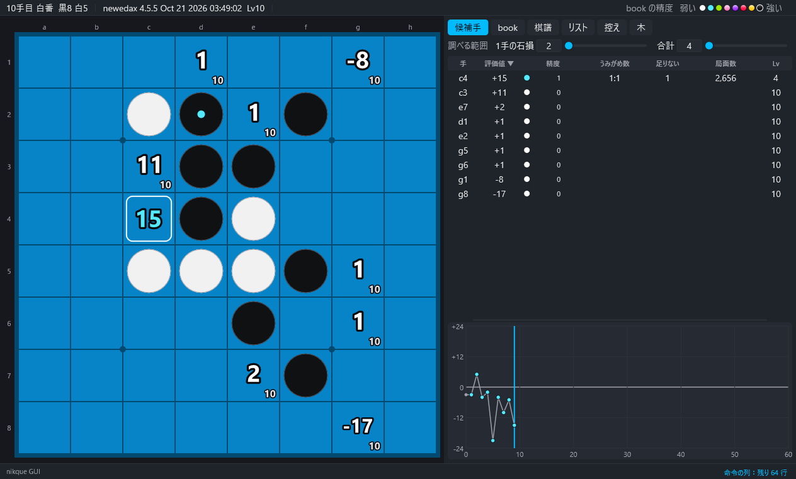

# nikque GUI

[日本語](#日本語) · [English](#english)

## 日本語

オセロのエンジン [Edax v4.5.5-nikque](https://github.com/Nikque/edax-reversi-AVX)（C 版）と [newedax](https://github.com/Nikque/newedax)（C++ 版）のための Windows の GUI です。

- 盤の上に全部の合法手の評価値と、book の精度（段階 0〜7）を出します。
- book の解析：次の段階に足りない leaf までの手順、うみがめ数、level ごとの局面数、最善の進行、book の進行の木。
- book の学習（deviate・enhance・fill など）、止める・途中保存から続ける・学習の列。
- 対局（人とコンピューター、コンピューターどうし、持ち時間、序盤を book から選ぶ）、比べるモード。
- 棋譜リスト（100 万局）、棋譜検索、控え、盤面配置、盤から手順の推定、エンジンの道具、命令の列。
- 画面の言葉：日本語・English・简体中文・繁體中文。

**ダウンロード**：[Releases](https://github.com/Nikque/nikque-gui/releases) の `nikque-gui-0.1.0.zip`（エンジン 2 つ入り、book なし）。展開して `nikque-gui.exe` を起動します。

**マニュアル**：[manual/ja](manual/ja/README.md)

### 組み立て

Visual Studio 2022（C++、x64）と CMake。`build.cmd` で `build\Release` に組み立て、単体の試験 6 本を流します。`build.cmd measure` は計測版（`build-measure`）。配布物は `tools\make_dist.ps1`。

### ライセンス

nikque GUI は MIT License（[LICENSE.txt](LICENSE.txt)）。配布物に入っているエンジンは GNU GPL v3 の別のプログラムで、GUI は子のプロセスとして起動し、文字の命令でやりとりします（ソースは上のリンク、配布物の `engines\*\SOURCE.txt`）。

## English

A Windows GUI for the Othello engines [Edax v4.5.5-nikque](https://github.com/Nikque/edax-reversi-AVX) (C version) and [newedax](https://github.com/Nikque/newedax) (C++ version).

- The values of all the legal moves and the accuracy of the book (stages 0 to 7) on the board.
- Book analyses: the lines to the leaves missing for the next stage, umigame numbers, positions by level, best lines, a tree of the book lines.
- Book learning (deviate, enhance, fill and others): stop, continue from the file saved on the way, a learning queue.
- Games (a person against the computer, the computer on both sides, time, opening moves from the book), compare mode.
- Game lists (a million games), search, kept lines, setting up a position, finding the moves of a position, engine tools, command scripts.
- Languages of the screen: Japanese, English, Simplified and Traditional Chinese.

**Download**: `nikque-gui-0.1.0.zip` in [Releases](https://github.com/Nikque/nikque-gui/releases) (two engines included, no book). Unpack it and start `nikque-gui.exe`.

**Manual**: [manual/en](manual/en/README.md)

### Building

Visual Studio 2022 (C++, x64) and CMake. `build.cmd` builds into `build\Release` and runs the 6 unit tests; `build.cmd measure` builds the measuring version (`build-measure`). `tools\make_dist.ps1` makes the distribution.

### License

nikque GUI: MIT License ([LICENSE.txt](LICENSE.txt)). The engines of the distribution are separate programs under the GNU GPL v3; the GUI starts them as child processes and talks to them with text commands (source: the links above, and `engines\*\SOURCE.txt` of the distribution).
