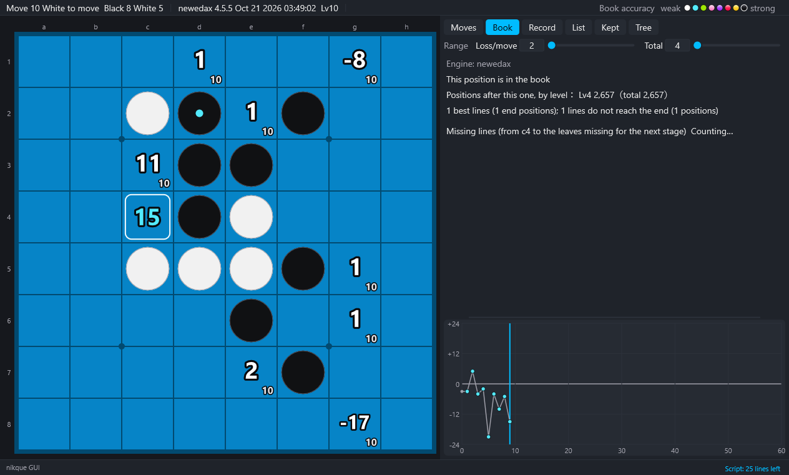
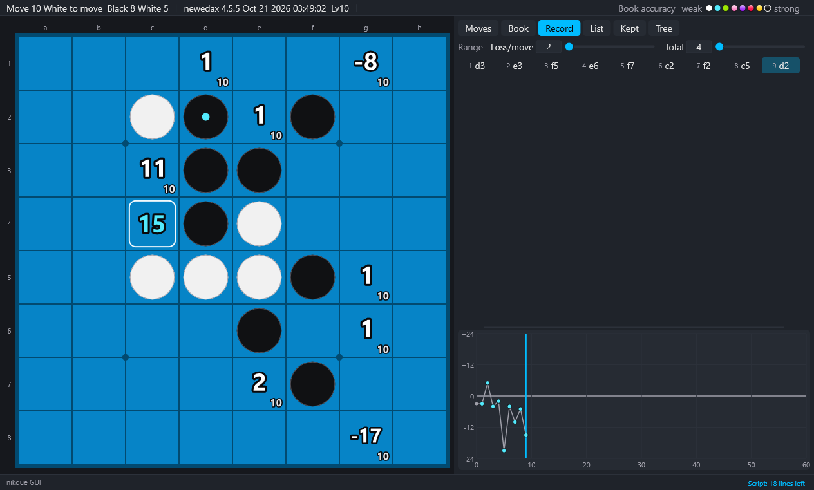

# 3. The screen

[Contents](README.md) · Previous: [2. Setting up](02-setup.md) · Next: [4. Analysis](04-analysis.md)

## Top bar

From the left, the top bar shows:

- the move number and the side to move
- the disc counts
- the engine (kind and version) and the search level
- during a game, the kind of game and the time left

At the right end is a color key for the book accuracy (weak to strong). Hover over a dot to see the meaning of its stage. When the book accuracy is not computed (a setting), the bar shows "Book accuracy: not computed" instead of the key.

The top bar also shows a message in these cases:

- no engine is running
- the book is being read
- the book is turned off
- the engine is too old
- the book path cannot be passed to the engine

## Board

- Every legal move shows its value (the disc difference from the side to move).
  - The small number at the lower right is the search depth (Lv).
  - A value searched to the end is marked "E".
- The colors and effects of the numbers show the accuracy stage of the book ([4. Analysis](04-analysis.md)).
- Frames around moves:
  - the best move: a thick frame
  - moves close to the best: a thin frame
  - the move selected in the Moves tab: a white frame
- Left-click to play a move. Right-click or press Left to go back one move.
- View → Number on the squares shows book positions, Lv, the accuracy stage or umigame numbers at the lower left of each square.

### Marks on the lines of the openings

A move that leads to a registered opening (`opening.ini`) has a mark at the upper right of its square.

- A filled mark: this move makes an opening.
- Only the outline: this move is on the way to an opening.

The mark is a ribbon in the standard design and a heart in the paw design. It is the same in every orientation of the board, and when another order of the moves reaches the same position.

View → Mark the moves on the lines of the openings turns them on or off (on at first). They stay when H hides the values.

### Opening names

When the position is a registered opening, its name is shown large under the board. Further on, the name of the last opening passed stays in dim letters. Going back shows the name for that position again.

A click on the name hides it and leaves a short "(opening)"; another click shows it again.

### Expected line on the board

With View → Show on the board the expected line of the move under the mouse turned on, hovering over a move draws the line that follows it (up to 12 moves) as semi-transparent discs with numbers.

- **This is off by default.**
- When it is off, the line is still shown as text in the bottom row (the log row).

## Design

View → Switch the design (key D) toggles between standard and paw. You can also choose one in View → Design.

## Right panel

The range (loss per move X and total Y) is at the top of the panel. These values are shared by the accuracy stages, the missing lines, the umigame numbers and the learning commands.

The tabs below it:

| Tab | What it shows |
|---|---|
| Moves | a table of all the moves: Move, Value, Accuracy, Umigame, Missing (leaves missing for the next stage), Positions, Lv. Click a heading to sort. Up/Down chooses a move, Enter plays it |
| Book | whether the position is in the book, the positions by level, the best lines (their end positions, the ends not solved), the missing lines after the chosen move |
| Record | the moves of the game (number and move); click to go to that position |
| List | the game list and the search results ([8. Games, lists and bookmarks](08-games.md)) |
| Tree | the book lines from the position shown ([5. Book](05-book.md)) |

- P hides the panel.
- Drag the border between the board and the panel to change the panel width.
- Drag the border between the table and the graph to change the graph height.

## Row of bookmarks

Pictures of the bookmarked positions appear just above the graph ([8. Games, lists and bookmarks](08-games.md)).

- M bookmarks the current position (same as Game → Bookmark the position now).
- When you start a new game or paste a game, the previous game is bookmarked automatically.
- Click a picture to go to its position.
- Right-click a picture to open its menu (go to it, compare with its game, delete it).
- Hovering over a picture shows its moves in the bottom row.
- When there are many pictures, scroll the wheel over the row to scroll it horizontally.
- With the mouse over the row, Delete deletes the selected bookmark.
- View → Bookmarks → Show the row of bookmarks shows or hides the row.

## Graph

The graph at the lower right shows the value at each position of the game.

- The vertical line marks the current position.
- Click the graph to go to the nearest position of the game.

## Log

The bottom row shows the last line of the log.

- Click it or press L to expand the log. It lists the engine responses, messages and tool output.
- View → Save the log… saves it to a file.

