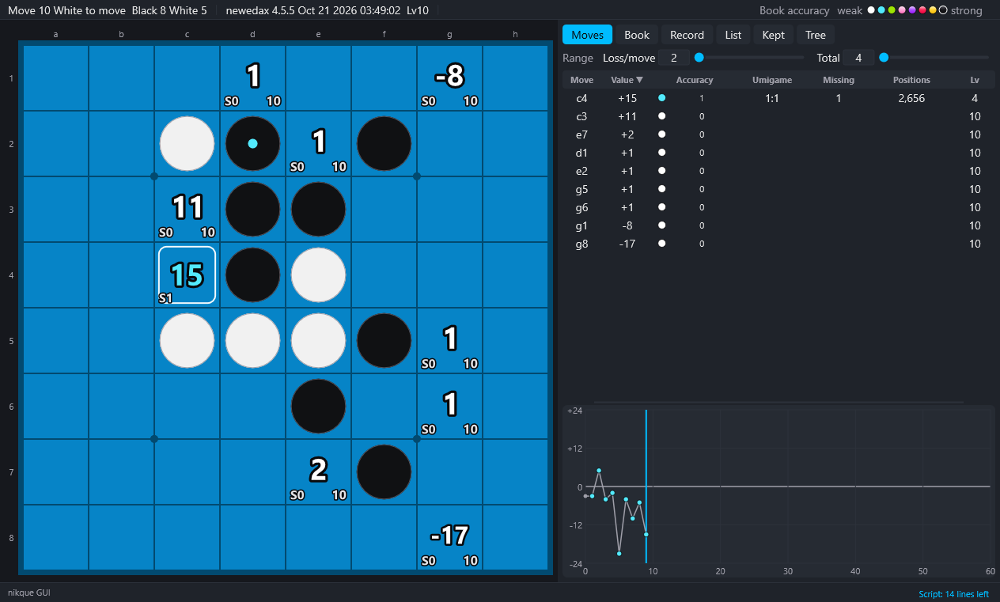

# 4. Analysis

[Contents](README.md) · Previous: [3. The screen](03-screen.md) · Next: [5. Book](05-book.md)

## Values

- When the position changes, the main engine starts the book analyses and the search engine searches all the moves. The values are disc differences from the side to move.
- When the position is moved, the work on the position before stops and the new position is computed at once. The work on another position for the graph waits until the position shown is done.
- A move in the book shows the book value (and the book Lv); the others show the search value (to the search level).
- Analysis → Show the values (H hides them), Compute again (the values kept are dropped and asked again).

## Search level

Analysis → Search level… chooses the level of Edax (0 to 60) with a slider or a number; the menu shows the level now. The higher, the deeper and the slower (21 is a good start). The Settings → Range… window sets it too.

## Searching the positions of the game in the background

The other positions of the game are searched by the search engine when it has nothing else to do, which fills the graph. The order is chosen in the Analysis menu:

| Item | What it does |
|---|---|
| Backward analysis | from the last position back; a value is corrected by the value of the next move, and a corrected value has a ★ on its Lv (the default) |
| Forward analysis | from the first position on; no value is corrected |
| Do not search the positions of the game in the background | only the position shown is searched |

## Stopping the background work

Input/Output → Stop the background work stops the work on the game list, the book analyses (the accuracy, the points of the graph, the counts), the count before book reduce (the book is not made lighter) and the search of the positions of the game. It starts again when the position changes. To keep it stopped, turn off Compute the book accuracy below, or choose Do not search the positions of the game in the background.

## Accuracy stages of the book (0 to 7)

For every move, how complete the book is after it. Hover over the dots of the top bar to see the colors and their meanings.

| Stage | Meaning |
|---|---|
| 0 | a move not in the book (search value) |
| 1 | in the book, but the best line does not reach a position solved to the end |
| 2 | the best line reaches the end, but leaves near the best remain |
| 3 to 7 | `book deviate x y` from the position after the move would add nothing (by default 3 is 1/1, 4 is 2/2 … 7 is 5/5) |

- Book → Accuracy based on: deviate, deviate2 or deviate3. The ranges (x/y) of the stages 3 to 7 are set in Settings → Range….
- Missing in the Moves table is the number of leaves missing for the next stage. The Book tab shows the lines to those leaves (the missing lines).
- From stage 3 on, the numbers have effects (light, gloss, stars…). View → Effects: on, subdued (still) or off; lower in the same menu, the strength of the effects of the top stage (stage 7): strong, normal or weak.

### Not computing the book accuracy

When the accuracy stages are too heavy for a large book, turn off Analysis → Compute the book accuracy (the Range… window has the same box). Off, a book move shows its value only, in white (without a Lv), and Accuracy in the Moves table shows "—". The umigame numbers are computed as set. Turned on again, the position shown is computed again.

## Umigame numbers

The smallest number of line ends to learn to know every line after the move (by default, the best moves of both sides), for black and for white ("black:white"). A position reached by different lines is counted once.

Analysis → Umigame numbers:

- Best lines only
- Up to the loss X, Y (the range values)
- Do not show

Settings → Range… also has a range of values and a depth to follow. With a wide range, a number that may not be the smallest gets "≦"; a number too large to compute is shown as such.

## Range

Loss/move X and Total Y at the top of the right panel are shared by the accuracy stages, the missing lines, the umigame numbers (with losses) and the learning commands. The Range… window also sets the accuracy base, whether the book accuracy is computed, the range of each stage, the umigame condition, the search level, the number of threads and the size of the hash table (changing the threads or the hash table restarts the engines).

## Book positions

With Analysis → Also count the book positions, the book positions after every move are counted. With a large book this takes time near the start (the levels and the best lines of the Book tab come after it).

## Number on the squares

View → Number on the squares: book positions, Lv (L), accuracy stage (S) or umigame numbers (black:white) at the lower left of each square.

## Compare mode

Analysis → Compare mode: the engine of the other kind is started for a search without the book, and the Moves table gets a Compare column. The evaluations of the nikque and newedax types are shown side by side.
