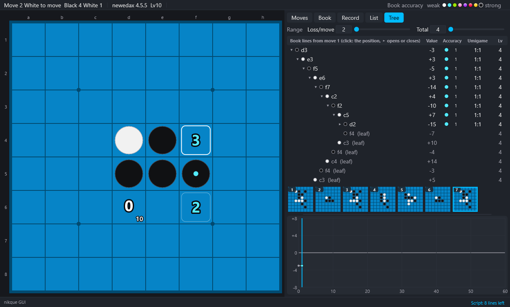

# 5. Book

[Contents](README.md) · Previous: [4. Analysis](04-analysis.md) · Next: [6. Learning](06-learning.md)

## Book tab

- Whether this position is in the book.
- The positions after this position, by level (and in all).
- Best lines: the number of lines where both sides play best moves only (their end positions), and the ends not solved.
- Missing lines: after the move chosen in the Moves tab or with Up/Down, the lines to the leaves missing for the next stage. Click a line to play up to the position where its leaf is to be added (not during a game against the computer).

With a large book this takes time near the start ("Counting…").

## Tree of the book

Book → Tree of the book, or the Tree tab: the book moves (links) from the position shown, in a tree that opens and closes.

- Each row: the disc of the side that plays, the move, the value (the book value from that side), the accuracy stage, umigame numbers, Lv.
- A leaf (the best move of a book position that is not in the book yet) is a faint row that does not open.
- Click a row to go to its position and open it; ▸ / ▾ opens or closes that row only.
- While you go on from the root the tree stays and the row of the position shown is colored; going back before the root or to another game makes a new root.
- When there are too many rows the tree stops and says so: close some rows.

## Output

- Book → Write the missing lines…: the missing lines of the Book tab, one a line (the moves from the start and the leaf move), to a text file. They can also go to the learning queue ([6. Learning](06-learning.md)).
- Book → Write the best lines…: from this position, the lines where both sides play best moves (or moves within a loss) to their ends, one a line (the loss, the depth, whether to stop at solved positions, all ends or the ends not solved only).
- Input/Output → Game list → Book lines into the list…: the same lines into the game list.

## Book contents to the log

Book → Book contents to the log: whole book (`book info`), counts (`book stats`), this position (`book show`).

## Another book, reading again

- Book → Open another book… (or drop a file on the window), Recent books. The main engine is started again with it.
- Book → Read again: after the file was changed outside.
- Book → Use the book (B): off, no book value is shown, only search values.

## Maintenance

Book → Book maintenance and output:

| Item | Engine command |
|---|---|
| Save, Save as | `book save` |
| New empty book | `book new` |
| Change the book depth | `book depth` |
| Show as problems | `book problem` |
| Merge another book | `book merge` |
| Keep only this position and after | `book subtree` |
| Keep only lines where one side plays best | `book prune` |
| Remove what deviate3 X Y cannot reach, to make the book lighter | `book reduce` (below) |
| Write to / read back from a text file | `book export` / `book import` |
| Write the best lines as games | `book extract` |

After a command that changes the book (subtree, prune, reduce, import, new…), the book file may be overwritten when the engine is closed; the confirmation window says so. Copy the book first.

## Making the book lighter (book reduce)

Book → Book maintenance and output → Remove what deviate3 X Y cannot reach, to make the book lighter (book reduce)…. Only the positions that `book deviate3 X Y` reaches from a position are kept; the others are removed, and the book gets smaller (an engine feature since v4.5.5-nikque.20 and newedax.5).

1. In the window, choose the largest loss of a move X (0 to 129), the largest sum of losses Y (0 to 254) and where from (the initial position, or the position shown). X and Y start at the range values. Usually choose the initial position; from the position shown, the positions from the initial position up to it are removed too.
2. The GUI first has the engine count (`book reducecount`, which does not change the book) and shows the numbers of positions kept and removed.
3. OK runs `book reduce X Y` as a learning command. At its end, the log gives the numbers of positions kept and removed.

- What is kept: the position and the positions reached from it by moves that lose at most X discs each, with at most Y discs lost in all (the range that `book deviate3 X Y` walks when it looks for the positions to expand). The values of the positions kept do not change from those computed again first.
- When Input/Output → Stop the background work is chosen while the positions are counted or after they are counted before the window comes, or when the engine closes (another book or engine too), the book is not made lighter. When the engine closes while the window is shown, OK does nothing either (since 0.2.1).
- When the book after the position is damaged (a link to a square already taken, a link back to the same position), the GUI says so and does nothing (engines since v4.5.5-nikque.21 and newedax.6).
- Engines since v4.5.5-nikque.22 and newedax.7, when the book has not changed since the count, use the count after OK to choose the positions kept instead of counting again (the engine setting `book-reduce-reuse`). The larger the book, the shorter the work after OK.
- The book is saved to its file when the engine is closed. To keep the original book, copy the file first, or save with Save as… and then read the original again with Read again.
- An older engine (nikque.19, newedax.4 and before) does not know the command: the GUI says so and does nothing.
- In a script: `book reduce X Y` (from the position shown: `book reduce X Y here`), without the question ([10. Command scripts](10-scripts.md)).
