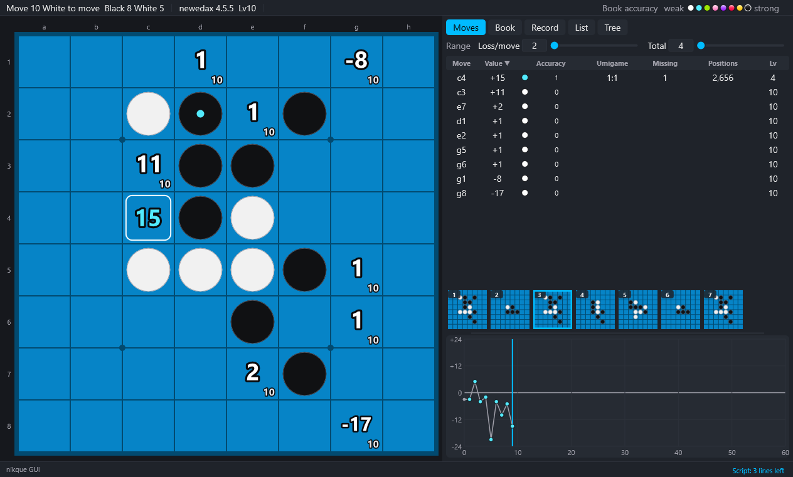

# 8. Games, lists and bookmarks

[Contents](README.md) · Previous: [7. Games](07-play.md) · Next: [9. Tools and files of games](09-tools.md)

## Copy and paste a game

- Input/Output → Copy the game (up to this position), Paste a game. With the keys, press Ctrl+C or Ctrl+V twice.
- Forms read: coordinates (`f5d6c3…`), board text (64 squares and the side to move), bitboards, the PARAM form of blogs.
- Fix the game: the game is fixed, and the games played after it are compared with it: a red frame on bad moves, a mark where they differ.

## Position text and bitboards

Input/Output → Position text and bitboards: copy the board text, a problem line (obf), the bitboards (decimal, hexadecimal, Ntest form). Read a position… reads one.

- Decimal and hexadecimal are "black white side" (a1 is bit 0, h8 bit 63; side X or O).
- The Ntest form is "empty-squares discs-of-the-side-to-move side".

## Setting up a position

E starts; E again or Enter finishes. While setting up: left click black → white → empty, right click empty, T side to move, Delete removes all discs, I the start position, Esc cancels.

## Finding the moves of a position

Input/Output → Find the moves of this position (up to move 20): makes a line that leads to the position on the board. A line through book positions only is looked for first (`book findline`); if there is none, it is searched without the book. When none is found, the log says that the search gave up, or that no line leads to the position.

## Game list

A text file with one game a line (`f5d6c3…`, or `<64 squares> <X|O>;moves` from another start). It is shown in the List tab; click a line to open the game.

Input/Output → Game list: Open, Add, Save, Add this game to the list, Book lines into the list, Sort (shorter first, then by the moves), Join the same games, Cut (every game to n moves), Shuffle (seed), One orientation (first move f5, also at later symmetric positions), Random orientations (at symmetric positions), Previous / Next game (Ctrl+Shift+Left/Right), Read this game again / Remove it (Ctrl+Shift+Down/Up), Empty the list, Open games at move.

- A list of a million games can be handled. Heavy work runs in the background; Input/Output → Stop the background work stops it.
- Stopping One orientation or Random orientations half way leaves the games turned so far as they are (the same games turned another way).

## Search

Input/Output → Search the list (games with this position): the games of the list where this position appears (other orientations too), shown in the List tab; click a line to open that position. Clear the search result clears it.

## Bookmarks

A bookmark keeps a game and a position in it. Right above the graph, pictures of the bookmarked positions are shown, the oldest at the left.

- M (Game → Bookmark the position now; also in View → Bookmarks) bookmarks the position shown. Another position of the same game is another bookmark.
- A new game, a pasted game, a position set up and a line found also bookmark the game before by themselves (no limit; `kept.txt` next to the exe). When the same game comes again, such a bookmark moves to its last position and stays one. A bookmark made with M does not move: another position of the same game becomes another bookmark (since 0.2.1; the bookmarks of a `kept.txt` of 0.2.0 or before are read as made by themselves).
- Click a picture to go to that position of its game. A right click opens a menu: Go to the chosen bookmark, Compare with the game of the chosen bookmark, Delete the chosen bookmark.
- Compare with the game of the chosen bookmark marks the game as a fixed game does (red frame on bad moves, marks where it differs).
- Hovering over a picture writes the number and the moves of the bookmark in the bottom row.
- View → Bookmarks → Delete all the bookmarks…, Show the row of bookmarks (shows or hides the row).

## Images

- Input/Output → Screenshot (Ctrl+P): the screen as a PNG in the `screenshots` folder next to the exe (`[view] screenshot_dir` of `config.ini` changes the place).
- Save the board as an image (PNG)…: the board alone.

## Opening names

The top bar shows the opening name read from `opening.ini` next to the exe (included): a text file of lines `name=moves` (moves from the start, f5 first; leading spaces only show the levels, lines starting with `//` are notes). It can be edited with Notepad. Another file can be set in `[view] opening_file=` of `config.ini`.
