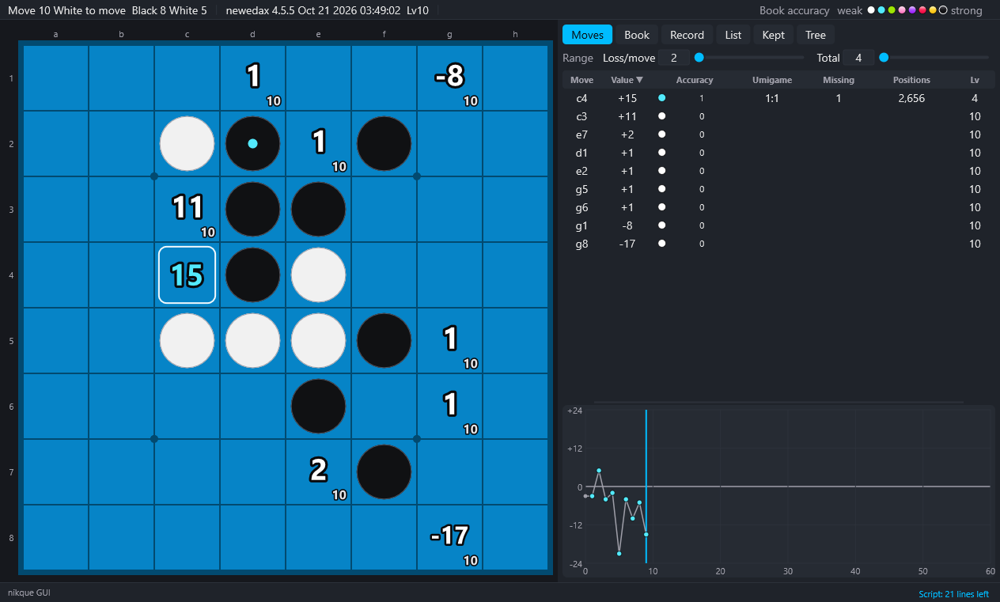

# nikque GUI user manual

[日本語](../ja/README.md)

nikque GUI is a Windows GUI for the Othello engines Edax v4.5.5-nikque (C version) and newedax (C++ version). It shows the values of all the legal moves and the accuracy of the book on the board, and runs book analyses, book learning, games and game lists from its menus.

## Contents

1. [Introduction](01-introduction.md): what it does, license
2. [Setting up](02-setup.md): the ZIP, the engines, the book, the language
3. [The screen](03-screen.md): top bar, board, right panel, graph, log
4. [Analysis](04-analysis.md): values, Lv, accuracy stages of the book, umigame numbers, range, compare mode
5. [Book](05-book.md): Book tab, tree of the book, output, maintenance
6. [Learning](06-learning.md): learning commands, stop and continue, learning queue, learning settings
7. [Games](07-play.md): kinds of game, computer level, time, opening moves
8. [Games, lists and kept lines](08-games.md): copy and paste, position text, setting up a position, finding the moves of a position, game list, search, kept lines
9. [Tools and files of games](09-tools.md): solve, bench, count, perft, estimate, base, command box
10. [Command scripts](10-scripts.md): operations written in a file and run in turn
11. [Settings](11-settings.md): config.ini, keys, view
12. [Troubleshooting](12-troubleshooting.md)

For nikque GUI 0.1.0 with the engines v4.5.5-nikque.19 and v4.5.5-newedax.4.
