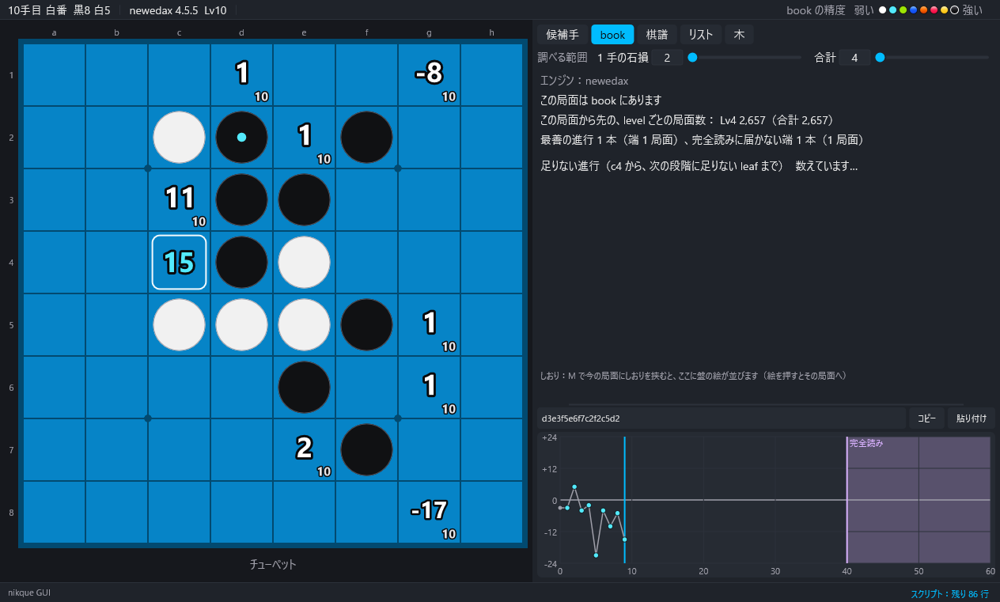
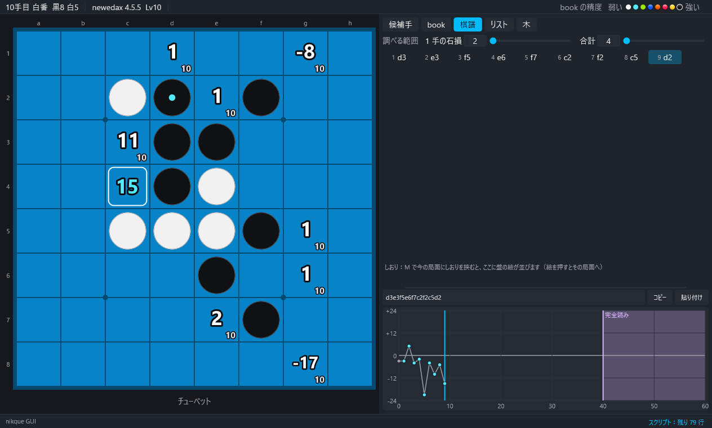

# 3. 画面

[目次](README.md) ・ 前：[2. 置き方と起動](02-setup.md) ・ 次：[4. 解析](04-analysis.md)

## 上の帯

左から次の順に表示します。

- 手数と手番
- 石の数
- エンジン（系列とバージョン）と評価の Lv
- 対局中は、対局の種類と残りの時間

右端には book の精度の色の見本（弱い〜強い）があります。玉にマウスを乗せると、その段階の意味が出ます。book の精度を計算しない設定のときは、見本の代わりに「book の精度：計算しない」と出ます。

次のときも、上の帯に表示が出ます。

- エンジンが動いていない
- book を読み込み中
- book を使わない設定
- 古いエンジン
- book の場所をエンジンに渡せない

## 盤

- すべての合法手に評価値（手番の側から見た石差）を表示します。
  - 右下の小さな数は探索の深さ（Lv）です。
  - 完全読みの値には「完」が付きます。
- 数字の色と効果は、book の精度の段階を表します（[4. 解析](04-analysis.md)）。
- 手を囲む枠：
  - 最善の手：太い枠
  - 最善に近い手：細い枠
  - 候補手タブで選んでいる手：白い枠
- 左クリックで打ちます。右クリックか ← で 1 手戻ります。
- 「表示」→「マスの左下に表示する数」で、マスの左下に book の局面数・Lv・精度の段階・うみがめ数を表示できます。

### 定石の手順の印

登録されている定石（`opening.ini`）へ進む手の右上に、印を付けます。

- 塗りつぶしの印：その手を打つと、定石の局面になります。
- 輪郭だけの印：その手は、定石へ進む手順の途中です。

印の形は、標準のデザインではリボン、肉球のデザインではハートです。盤の向きが違っても、手順が入れ替わって同じ局面になっても、同じように付きます。

「表示」→「定石の手順の手に印を付ける」で切り替えます（初めはオンです）。H で評価値を隠しても、印は出ます。

### 定石名

登録されている定石の局面に着くと、盤の下に定石名を大きく出します。その先へ進むと、最後に通った定石の名前を薄い字で残します。手を戻せば、その局面に合わせて出し直します。

定石名をクリックすると隠れ、「（定石名）」の短い表示だけが残ります。もう一度クリックすると出ます。

### 読み筋の表示

「表示」→「マウスを乗せた手の読み筋を盤に表示する」をオンにすると、手にマウスを乗せたとき、その手の後の読み筋（最大 12 手）を半透明の石と番号で盤に表示します。

- **初期設定ではオフです。**
- オフのときも、読み筋はいちばん下のログの行にテキストで出ます。

## デザイン

「表示」→「デザインを切り替える」（キーは D）で、標準と肉球を切り替えます。「表示」→「デザイン」からも選べます。

## 右のパネル

パネルの上に「調べる範囲」（1 手の石損 X と合計 Y）があります。この値は、精度の段階・足りない進行・うみがめ数・学習で共通に使います。

その下のタブ：

| タブ | 中身 |
|---|---|
| 候補手 | 全部の手の表。列：手・評価値・精度・うみがめ数・足りない（次の段階に足りない leaf の数）・局面数・Lv。列の見出しを押すと並べ替えます。↑↓ で選び Enter で打ちます |
| book | この局面が book にあるか、level ごとの局面数、最善の進行の数（端の局面の数、完全読みに届かない端）、選んだ手の先の足りない進行 |
| 棋譜 | 今の棋譜の手順（番号と手）。押すとその局面へ行きます |
| リスト | 棋譜リストと棋譜検索の結果（[8. 棋譜・リスト・しおり](08-games.md)） |
| 木 | 今の局面から先の book の進行（[5. book](05-book.md)） |

- パネルは P で隠せます。
- 盤との境目をドラッグすると、パネルの幅が変わります。
- 表とグラフの境目をドラッグすると、グラフの高さが変わります。

## しおりの列

グラフのすぐ上に、しおりを挟んだ局面の盤の絵が並びます（[8. 棋譜・リスト・しおり](08-games.md)）。

- M で今の局面にしおりを挟みます（「対局」→「今の局面にしおりを挟む」も同じ）。
- 新しい対局を始めたときや棋譜を貼り付けたときも、それまでの棋譜に自動でしおりが挟まれます。
- 絵を押すと、その局面へ行きます。
- 絵を右クリックすると、メニュー（その局面へ・その棋譜と比べる・消す）が出ます。
- 絵にマウスを乗せると、いちばん下の行に手順が出ます。
- 絵が多いときは、列の上でホイールを回すと横にスクロールします。
- マウスを列に乗せて Delete を押すと、選んでいるしおりを消します。
- 「表示」→「しおり」→「しおりの列を表示する」で、列の表示・非表示を切り替えます。

## 棋譜の欄

グラフのすぐ上の入力欄に、今の局面までの棋譜が座標の列で出ます。局面を動かすと、欄も変わります。

- 「コピー」を押すと、今の局面までの棋譜をコピーします（メニューの「棋譜をコピー」と同じです）。欄の文字の一部を選んで Ctrl+C でコピーすることもできます。
- 「貼り付け」を押すと、コピーしてある棋譜をすぐに読み込みます。欄を押して Ctrl+V を押す、または欄を右クリックして貼り付けても同じです（1 回で読み込みます）。
- 「入出力」→「棋譜を大文字で出力する（F5D6…）」を入れると、欄とコピーの棋譜が大文字になります。読み込みは大文字でも小文字でもできます。
- 欄に手で打ったときは、Enter で読み込みます。
- 読み込めないときは、いちばん下の行に知らせが出て、今の棋譜はそのままです。手で打った文字は残るので、直して Enter を押せます。
- Esc を押すか、欄の外を押すと、手で打った文字は消えて元に戻ります。別の窓へ移ったときも同じです。
- 欄を押すと、矢印キーなどのキーは欄の中で働きます。盤など欄の外を押すか、Esc を押すと、キーで局面を動かせるようになります。読み込んだ後も同じです。
- 読める形は「棋譜を貼り付け」と同じです（[8. 棋譜・リスト・しおり](08-games.md)）。
- 盤面配置の間は読み込みません。
- 「表示」→「棋譜の欄を表示する（グラフの上）」で、欄の表示・非表示を切り替えます。

## グラフ

右下に、棋譜の局面ごとの評価値を表示します。

- 縦の線が今の局面です。
- グラフを押すと、押した所にいちばん近い棋譜の局面へ行きます。
- 紫の帯と線は、今の Lv で読み切る手数の範囲です。線は読み方が変わる手数で、上に確率（87%・98% など）か「完全読み」が付きます。帯は濃いほど確かな読みです。例えば Lv 21 では、30 手目から 87%、33 手目から 98%、36 手目から完全読みです。
- 「表示」→「グラフに読み切りの範囲を表示する（今の Lv）」で、帯と線の表示・非表示を切り替えます。

## ログ

いちばん下の 1 行が、ログの最後の行です。

- 押すか L で広がり、エンジンの応答・メッセージ・ツールの出力が並びます。
- 「表示」→「ログを保存…」でファイルに保存できます。

