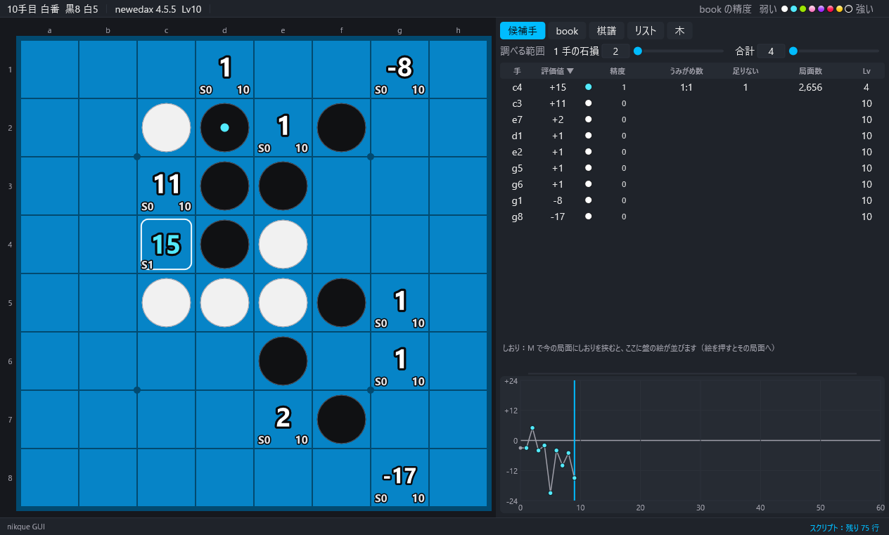

# 4. 解析

[目次](README.md) ・ 前：[3. 画面](03-screen.md) ・ 次：[5. book](05-book.md)

## 評価値

- 局面が変わると、メインエンジンが book の解析を、探索用エンジンが全部の手の探索を始めます。値は手番の側から見た石差です。
- 局面を動かすと、前の局面の計算は止めて、新しい局面の計算をすぐに始めます。グラフのための別の局面の計算も、今の局面の計算が済むまで待たせます。
- book にある手は book の値（book の Lv）、ない手は探索の値（評価の Lv の深さ）です。
- 「解析」→「評価値を表示する」（H で隠す）、「再計算する」（覚えた値を捨てて頼み直す）。

## 評価の Lv

「解析」→「評価の Lv…」で、Edax の Lv（0〜60）をスライダーか数で選びます。メニューに今の Lv が出ます。大きいほど深く読み、時間がかかります（21 が目安）。「設定」→「調べる範囲…」の窓でも選べます。

## 棋譜の局面を裏で読む

棋譜のほかの局面も、探索用エンジンが手の空いたときに裏で読み、グラフを埋めます。「解析」で読む順を選びます。

| 項目 | 働き |
|---|---|
| 後ろから解析 | 最後の局面から前へ読み、次の手の値で今の値を直します。直した値の Lv に ★ が付きます（初めはこれ） |
| 前から解析 | 最初の局面から後ろへ読みます。値は直しません |
| 棋譜の局面を裏で読まない | 今の局面だけを読みます |

## 裏の処理を止める

「入出力」→「裏の処理を止める」で、棋譜リストの処理、book の解析（精度の計算・グラフのための計算・局面数）、book を軽くする前の数え（book は軽くしません）、棋譜の局面の裏読みを止めます。局面を動かすと、また始まります。ずっと止めておきたいときは、下の「book の精度を計算する」を切るか、「棋譜の局面を裏で読まない」を選びます。

## book の精度の段階（0〜7）

手ごとに、その手の後の book がどこまでできているかを表します。上の帯の見本の玉にマウスを乗せると、色と意味が出ます。

| 段階 | 意味 |
|---|---|
| 0 | book にない手（探索の値） |
| 1 | book にあるが、最善の進行が完全読みまで届いていない |
| 2 | 最善の進行は完全読みまで届くが、最善に近い候補の leaf が残っている |
| 3〜7 | その手の後の局面から `book deviate x y` をしても何も増えない（既定の範囲は 3 が 1/1、4 が 2/2 … 7 が 5/5） |

- 「book」→「精度の基準」で、基準のコマンドを deviate・deviate2・deviate3 から選びます。段階 3〜7 の範囲（x/y）は「設定」→「調べる範囲…」で変えられます。
- 候補手タブの「足りない」は、次の段階に足りない leaf の数です。book タブで、その leaf までの手順（足りない進行）を見られます。
- 段階 3 からは効果（光・光沢・星など）が付きます。「表示」→「効果」で入・控えめ（動かさない）・切を選び、同じメニューの下の方で、いちばん上の段（段階 7）の効果の強さ（強い・ふつう・弱い）を選びます。

### book の精度を計算しない

大きな book で精度の計算が重いときは、「解析」→「book の精度を計算する」を切ります（「設定」→「調べる範囲…」にも同じ欄があります）。切ると、book の手は評価値だけを白い数字で出し（Lv は付きません）、候補手タブの「精度」は「—」になります。うみがめ数は、その設定のまま計算します。入れ直すと、今の局面から計算し直します。

## うみがめ数

その手の後の進行（既定は両方の最善の手）を全部知るために覚える、いちばん少ない端の数です。黒・白それぞれ「黒:白」で出します。違う手順で着く同じ局面は 1 回だけ数えます。

「解析」→「うみがめ数」：

- 最善の進行だけ
- 石損 X・Y まで（調べる範囲の値）
- 表示しない

「設定」→「調べる範囲…」で、評価値の範囲で数える形とたどる深さも選べます。範囲が広くて、いちばん少ないと言い切れない数には「≦」が付き、大きすぎる数は「大きすぎ」と出ます。

## 調べる範囲

右のパネルの上の「1 手の石損 X」と「合計 Y」は、精度の段階・足りない進行・うみがめ数（石損の形）・学習のコマンドで共通です。「設定」→「調べる範囲…」の窓では、ほかに精度の基準、book の精度を計算するか、段階ごとの範囲、うみがめ数の条件、評価の Lv、スレッドの数、ハッシュ表の大きさを変えられます（スレッドとハッシュ表を変えるとエンジンを再起動します）。

## book の局面数

「解析」→「book の局面数も数える」を入れると、手ごとにその手の先の book の局面の数を数えます。大きな book では序盤ほど時間がかかります（数え終わるまで、book タブの levels と最善の進行も後で出ます）。

## マスの左下に表示する数

「表示」→「マスの左下に表示する数」で、マスの左下に次のどれかを出します：book の局面数、Lv（L）、精度の段階（S）、うみがめ数（黒:白）。

## 比較モード

「解析」→「比較モード」：もう一方の系のエンジンを book なしの探索だけで起動し、候補手の表に「比較」の列を足します。nikque 系と newedax 系の評価関数の違いを並べて見られます。
