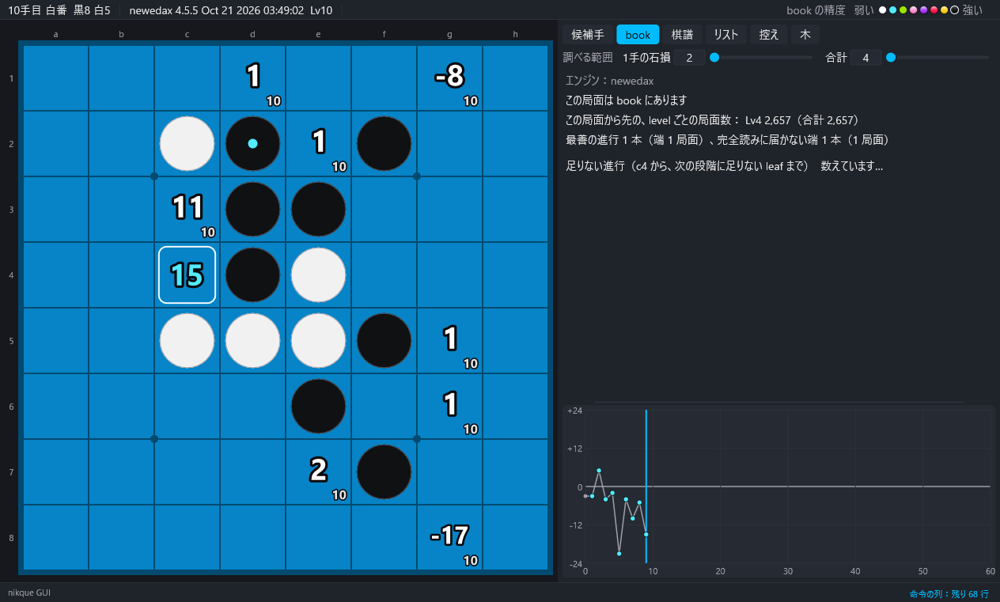
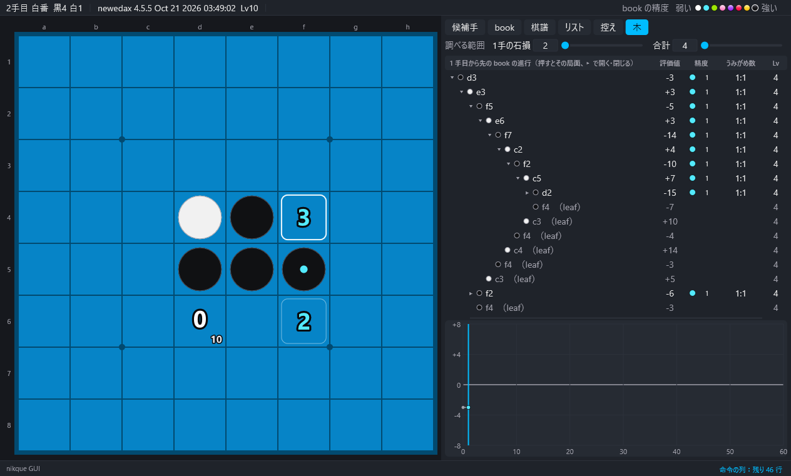

# 5. book

[目次](README.md) ・ 前：[4. 解析](04-analysis.md) ・ 次：[6. 学習](06-learning.md)

## book のタブ

- この局面が book にあるか。
- この局面から先の、level ごとの局面数（合計）。
- 最善の進行：両方が最善の手だけを打つ進行の数（端の局面の数）と、そのうち完全読みに届かない端の数。
- 足りない進行：候補手のタブか ↑↓ で選んだ手の先の、次の段階に足りない leaf までの手順。行を押すと、leaf を足す局面まで打ちます（コンピューターとの対局中は動きません）。

大きな book の序盤では、数えるのに時間がかかります（「数えています…」）。

## 木の表示

「book」→「木の表示」か、木のタブ。今の局面から先の book の手（link）を、開け閉めできる木で並べます。

- 各行：打つ側の石の色、手、評価値（打つ側から見た book の値）、精度の段階、うみがめ数、Lv。
- leaf（book の局面からの、まだ book にない最善の手）は薄い行で出し、開けません。
- 行を押すと、その局面へ進んでその段を開きます。▸ / ▾ を押すと、その段だけを開く・閉じます。
- 盤で根より先へ進む間は木がそのままで、今の局面の行に色が付きます。根より前に戻るか別の棋譜にすると、そこが新しい根になります。
- 行が多すぎるときは途中までにして知らせます。開いた所を閉じてください。

## 書き出し

- 「book」→「足りない進行を書き出す…」：book のタブに出ている足りない進行を、1 行 1 本（初めの局面からの手順と、足す leaf の手）で文字のファイルに書き出します。学習の列にまとめて入れることもできます（[6. 学習](06-learning.md)）。
- 「book」→「最善の進行を書き出す…」：今の局面から、両方が最善（または石損の幅まで）の手だけを打つ進行の端までの手順を、1 行 1 本で書き出します（石損・深さ・完全読みの局面で止めるか・全部か完全読みに届かない端だけか、を選べます）。
- 「入出力」→「棋譜リスト」→「book の進行をリストへ…」：同じ進行を、ファイルではなく棋譜リストに入れます。

## book の中身をログに

「book」→「book の中身をログに出す」：book 全体の情報（`book info`）、数の内訳（`book stats`）、今の局面の中身（`book show`）。

## 別の book、読み直す

- 「book」→「別の book を開く…」（窓にファイルを落としても）、「最近の book」。主のエンジンを起動し直して読みます。
- 「book」→「読み直す」：ファイルを外で変えたとき。
- 「book」→「book を使う」（B）：切ると、book の値を出さず探索の値だけにします。

## book の整理

「book」→「book の整理・書き出し」：

| 項目 | エンジンの命令 |
|---|---|
| 保存する・別の名前で保存する | `book save` |
| 新しい空の book | `book new` |
| book の深さを変える | `book depth` |
| 問題の形で出す | `book problem` |
| 別の book を取り込む | `book merge` |
| 今の局面から先だけを残す | `book subtree` |
| 片方が最善を打つ変化だけを残す | `book prune` |
| 文字のファイルに書き出す・読み戻す | `book export`・`book import` |
| 最善の手順を棋譜に書き出す | `book extract` |

subtree・prune・import・new などの book を変える命令の後は、エンジンを閉じるときに book のファイルが上書きされることがあります。確かめの窓にも出ます。先に写しを取ってください。
