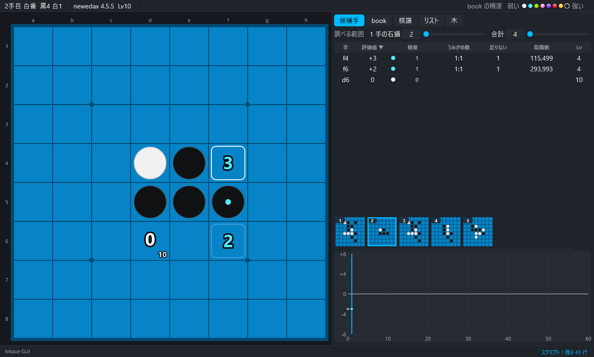

# 8. 棋譜・リスト・しおり

[目次](README.md) ・ 前：[7. 対局](07-play.md) ・ 次：[9. ツールと棋譜のファイル](09-tools.md)

## 棋譜のコピー・貼り付け

- 「入出力」→「棋譜をコピー（今の局面まで）」・「棋譜を貼り付け」。キーでは Ctrl+C、Ctrl+V は 2 回押します。
- 貼り付けられる形：座標の列（`f5d6c3…`）、盤面の文字列（64 マスと手番）、ビットボード、ブログの PARAM の形。
- 「棋譜を固定する」：今の棋譜を固定し、その後に打った棋譜と比べて、悪手に赤枠、違う手の所に印を付けます。

## 局面の文字列とビットボード

「入出力」→「局面の文字列・ビットボード」：盤面の文字列、問題の形式（obf）、ビットボード（10 進・16 進・Ntest の形式）をコピーします。「局面を取り込む…」で読み込みます。

- 10 進・16 進は「黒 白 手番」（a1 が 0 ビット目、h8 が 63 ビット目、手番は X か O）。
- Ntest の形式は「空き 手番の側の石 手番」。

## 盤面配置

E で始め、もう一度 E か Enter で決めます。配置中は、左クリックで黒 → 白 → 空き、右クリックで空き、T で手番、Delete で全部消す、I で初期配置、Esc でやめる。

## 盤から手順を推定する

「入出力」→「盤から手順を推定する」（20 手目まで）：今の盤の局面に着く手順を作ります。まず book の局面だけを通る手順を探し（`book findline`）、無ければ book を使わずに探します。見つからないときは「探しきれませんでした」か「この局面に着く手順はありません」と出ます。

## 棋譜リスト

1 行に 1 局のテキストファイル（`f5d6c3…`、または `<64 マス> <X|O>;手順` で別の最初の局面から）。リストタブに出て、行を押すとその棋譜を開きます。

「入出力」→「棋譜リスト」のメニュー：読み込む・追加する・保存する、今の棋譜をリストに追加、book の進行をリストへ、並べ替える（短い順、同じ長さは手順の順）、同じ棋譜をまとめる、短くする（各棋譜を n 手まで）、並びを混ぜる（乱数の種）、向きをそろえる（初手を f5 に。後の対称な局面でも決まった向きに）、向きをばらばらにする（対称な局面で乱数）、前・次の棋譜（Ctrl+Shift+← →）、今の棋譜を読み込み直す・消す（Ctrl+Shift+↓ ↑）、リストを空にする、何手目から表示するか。

- 100 万局のリストも扱えます。重い処理は裏で行い、「入出力」→「裏の処理を止める」で止められます。
- 向きをそろえる・ばらばらにするを途中で止めると、それまでに向きを変えた棋譜は変えたまま残ります（同じ棋譜の別の向き）。

## 棋譜検索

「入出力」→「棋譜検索（今の局面が現れる棋譜）」：リストの中から、今の局面（向きの違うものも含む）が現れる棋譜を探し、結果をリストタブに出します。行を押すとその局面を開きます。「検索の結果を消す」で結果を消します。

## しおり

しおりは、棋譜とその中の局面を残しておく機能です。グラフのすぐ上に、しおりを挟んだ局面の盤の絵が、古い順に左から並びます。

- M（「対局」→「今の局面にしおりを挟む」、「表示」→「しおり」の中にも同じ項目）で、今の局面にしおりを挟みます。同じ棋譜でも、違う局面なら別のしおりになります。
- 新しい対局・棋譜の貼り付け・盤面配置・手順の推定のときも、それまでの棋譜に自動でしおりが挟まれます（数の制限なし。exe の隣の `kept.txt`）。
- 絵を押すと、その棋譜のその局面へ行きます。右クリックで「選んだしおりの局面へ」「選んだしおりの棋譜と比べる」「選んだしおりを消す」のメニューが出ます。
- 「選んだしおりの棋譜と比べる」：固定の棋譜と同じ印（悪手に赤枠、違う手の所に印）で比べます。
- 絵にマウスを乗せると、いちばん下の行に、しおりの番号と手順が出ます。
- 「表示」→「しおり」→「しおりを全部消す…」、「しおりの列を表示する」（列を出す・隠す）。

## 画像

- 「入出力」→「スクリーンショット」（Ctrl+P）：exe の隣の `screenshots` フォルダに画面を PNG で保存します（`config.ini` の `[view] screenshot_dir` で場所を変えられます）。
- 「盤の図を保存する（PNG）…」：盤だけの図。

## 定石名

exe の隣の `opening.ini`（付いています）を読んで、上の帯に定石名を出します。テキストファイルで、1 行に `名前=手順`（手順は初手を f5 として書きます。行の頭の空白は段を見せるだけ、`//` で始まる行は注釈）。メモ帳などで直せます。ほかのファイルを使うときは `config.ini` の `[view] opening_file=` に書きます。
