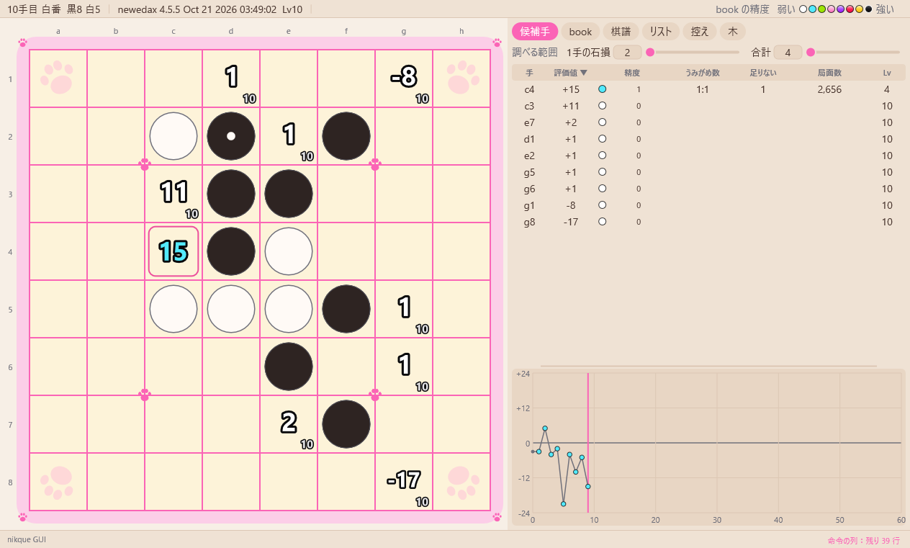

# 11. 設定

[目次](README.md) ・ 前：[10. スクリプト](10-scripts.md) ・ 次：[12. 困ったときは](12-troubleshooting.md)

## 表示

「表示」のメニュー：

- デザインを切り替える（D）：標準と肉球を切り替えます。「デザイン」から選ぶこともできます。
- 効果：入・控えめ（動かさない）・切。同じメニューの下の方で、いちばん上の段（段階 7）の効果の強さ（強い・ふつう・弱い）を選びます。
- 盤の向き：8 通りです（R で順に切り替え）。棋譜そのものを対称に変換します。
- 手の番号を石に表示する。
- マウスを乗せた手の読み筋を盤に表示する（初期設定ではオフ）。
- マスの左下に表示する数（[4. 解析](04-analysis.md)）。
- タブ。
- しおり（しおりの列を表示する、など）。
- 右のパネルを隠す（P）、ログ欄を広げる（L）、ログを保存…。

## config.ini

「設定」→「config.ini を開く」で、メモ帳で開きます。

GUI を閉じるときにも書き直されます。手で編集するときは、GUI を閉じてからにしてください。

| 節 | 主な項目 |
|---|---|
| `[engine]` | `kind=nikque\|newedax`、`search=1`（探索用エンジンを使う） |
| `[nikque]`・`[newedax]` | `dir`（エンジンのフォルダ）・`exe`（`auto` か exe の名前）・`eval`・`book` |
| `[analysis]` | `level`（0〜60）・`threads`（0 は全部）・`hash`（ハッシュ表のビット数、0 はエンジンのまま）・`umi`・`x`・`y`・`base`・`stages`・`precision`（1 で精度を計算する）・`backward`・`forward`（棋譜の局面を裏で読む順）・`compare` |
| `[play]` | `level`・`opening`（`search\|best\|wide`）・`width`・`until`・`clock`・`ponder`・`end_keep`・`end_list` |
| `[view]` | `design`・`effects`・`language`・`numbers`・`pv`（1 で読み筋を盤に表示）・`cell_info`・`fps`・`font`・`opening_file`・`screenshot_dir` |
| `[window]` | 大きさと場所、`tab`、`panel_w`、`bookmarks`（1 でしおりの列を表示） |
| `[list]` | `start_ply`（棋譜リストの棋譜を開く手数、-1 は最後） |
| `[learn]` | 最後の学習のコマンドと局面（「途中保存から再開」が使う） |
| `[learn_options]` | エンジンに送る学習の設定（[6. 学習](06-learning.md)） |
| `[tools]` | ツールのウィンドウの値、コマンドの入力の最後のコマンド |
| `[script]` | `startup`（起動のときのスクリプト） |
| `[keys]` | キーの割り当て |

## キー

既定の割り当てです。

- `[keys]` ですべて変えられます（例：`back=Left, Backspace`）。
- 「ヘルプ」→「キーの一覧」で、今の割り当てが表示されます。

| キー | 動き |
|---|---|
| ← → | 1 手戻る・進む（右クリックでも 1 手戻る） |
| Ctrl+← → | 10 手 |
| N・Home / End | 最初・最後の局面 |
| ↑ ↓ / Enter・Space | 候補手を選ぶ / 打つ |
| B / U / H | book を使う・うみがめ数・評価値を隠す |
| R | 盤の向き |
| D | デザインを切り替える |
| M | 今の局面にしおりを挟む |
| E | 盤面配置を始める・決める |
| Ctrl+C / Ctrl+V | 棋譜をコピー / 貼り付け（2 回押す） |
| Ctrl+P | スクリーンショット |
| Ctrl+Shift+← → | 棋譜リストの前・次の棋譜 |
| Ctrl+Shift+↑ ↓ | 棋譜リストの今の棋譜を消す・読み込み直す |
| P / L | 右のパネル・ログ欄 |

## ファイル

- exe の隣に作るファイル：`kept.txt`（しおり）、`screenshots\`（スクリーンショット）。
- 読み込むファイル：`opening.ini`（定石名。付属）。
